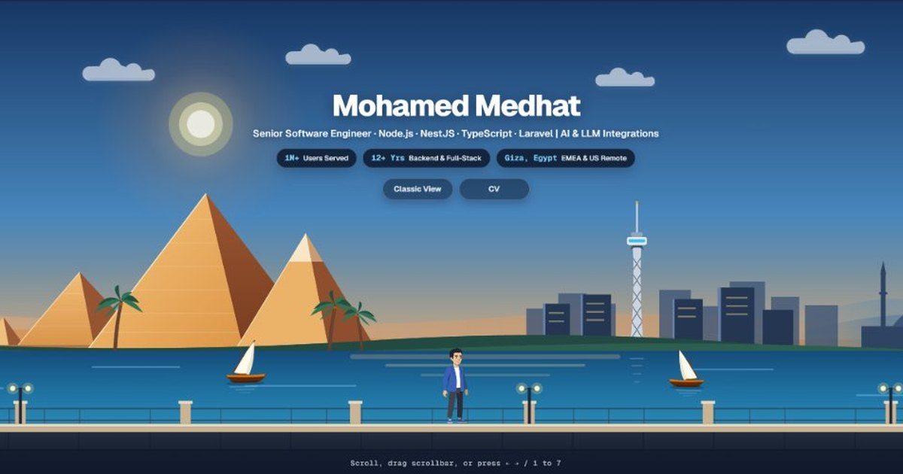

  

# Mohamed Medhat · Interactive Career World

Live portfolio of **Mohamed Medhat Kamal**, Senior Software Engineer (12+ years building Node.js, NestJS, TypeScript, Laravel, and AI systems serving 1M+ users).

**Live Site:** [m-medhat-dev.github.io](https://m-medhat-dev.github.io/) · **Classic View:** [m-medhat-dev.github.io/classic.html](https://m-medhat-dev.github.io/classic.html)

## Highlights

- **Zero-framework interactive 2D world:** Scroll-driven career journey from Cairo and NYC through underground enterprise systems, Gulf platforms, SmartX IIoT, and Space AI.
- **Mobile ready:** Dedicated portrait viewport scaling and touch ergonomics.

## Connect

- **LinkedIn:** [Mohamed Medhat](https://www.linkedin.com/in/mohamed-medhat-4b646b165/)
- **Email:** [m.medhat.developer@gmail.com](mailto:m.medhat.developer@gmail.com)
